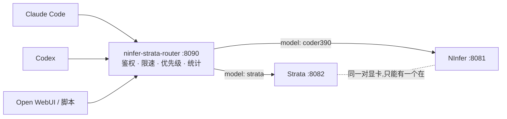

# ninfer-strata 本地路由方案

**一个接口,两个本地大模型,用哪个就加载哪个。**

`ninfer-strata-router` 是一个单文件、只依赖 Python 标准库的反向代理。它把**两个各自需要独占
同一组显卡**的本地推理服务(本方案里是 [Strata](https://github.com/Niko1221/Strata) 与
NInfer-DFlash)放到**同一个 OpenAI / Anthropic 兼容端点**后面,按请求里的模型名自动启动需要的那一个、
停掉占着显存的另一个,并把同一套鉴权、限速、优先级和用量统计加在两者之上。

实测环境:Windows 11、2 × Tesla V100、Strata 加载 IQ3_S 量化模型、NInfer-DFlash 加载
Qwen3.8 27B Coder390。

它不只是一个负载均衡器:两个后端对同一份请求的**协议细节**(路径前缀、推理档位名、字段集合、工具
结果形状)并不一致,而各家客户端(Claude Code、Codex、Open WebUI)对同一份 API 的写法也不一致。
这些差异都在这里被抹平。

---

## 它解决什么问题

在一块或一对显卡上,通常只能常驻一个较大的模型。于是你会遇到这些具体的麻烦:

| 麻烦 | 这个路由的处理 |
| --- | --- |
| 两个模型各占一个端口,客户端要来回改地址 | 只暴露一个端口,按模型名分流 |
| 启动第二个模型必须先手动关掉第一个 | 自动停掉对方、等显存释放、再启动 |
| 切换时把别人正在写的回答掐断 | 先等对方答完(可配置窗口),等不到才拒绝或强切 |
| Strata 要 `--max-context`、NInfer 要 `--kv-capacity`,参数各写一遍 | 每个模型的启动命令写进配置,按需执行 |
| Claude Code 的 base URL 不能带 `/v1`,Codex 必须带 | 路径自动纠正,两种写法都对 |
| NInfer 只认 `low/medium/xhigh`,客户端发的是 `high` | 按模型映射档位名 |
| NInfer 对不认识的字段直接 400 | 逐字段兼容:摘除、过滤或转换 |
| 公网暴露后没有鉴权、没有限速 | 内置多 key 鉴权、管理员 key、按 key 限速 |
| 不知道谁用了多少 token、跑多快 | 每个请求与累计的 token 用量、解码速度 |

---

## 特性

**路由**

- 一个端点同时提供 OpenAI Chat Completions、OpenAI Responses、Anthropic Messages 三种协议,
  都是**原样透传**,包括 SSE 流式。
- 按请求体里的 `model` 字段选后端,支持别名(一个模型可以有多个名字)。
- `GET /v1/models` 由路由自己回答,一次列出所有可用的模型,客户端的模型下拉里两个都在。
- 未知模型名回退到"当前已加载的那个",再回退到 `default_model`(可配置)。

**按需加载**

- 请求打到哪个模型,就启动哪个;启动前先停掉另一个,并**等显存真正释放**再加载。
- 启动超时、停止超时、就绪探测路径都可以按模型配置。
- 后端进程被放进一个 Windows **Job Object**:路由窗口一关,它启动的模型一起退出,不会留下
  占着显存的孤儿进程。另有一层"残留进程回收",按 GPU 上的进程名清理。

**并发与优先级**

- `max_inflight`:同时在飞的请求上限,超出返回 `503`。
- 同一模型内后端仍是一次一个请求,多出来的在模型内部排队。
- **切换前排空**:要切走一个模型时,先等它正在写的回答结束(默认 45 秒)。等不到就返回
  `503 + Retry-After`,而不是把别人的回答掐断。
- **管理员优先**:管理员 key 不受限速与并发上限约束;切换时窗口更长(默认 300 秒),到点后
  强制接管;管理员请求等待期间,该模型对新来的普通请求**熔断**(`503 admin_priority`),
  避免管理员排在一条不断变长的队尾。

**鉴权与限速**

- 多个 API key,`Authorization: Bearer <key>` 或 `x-api-key: <key>` 都可以。
- 按 key 的令牌桶限速,超出返回 `429 + Retry-After`,`requests_per_minute: 0` 可关闭。
- `admin_keys` 免限速、免并发上限;`admin_only_paths` 里的控制接口只对管理员开放。
- 只有健康检查路径免鉴权,其余**一律**要求 key——包括来自本机的请求。

**可观测性**

- 每个请求结束在路由窗口打印一行:模型、路径、状态码、输入/输出 token、解码速度、首字节延迟、总耗时。
- 每分钟一条累计汇总(只有发生新请求时才打印)。
- `GET /router/metrics` 返回 JSON:总量、按模型、按 key、最近 20 条明细。

**协议兼容层**

- 路径前缀自动纠正:`/responses` ↔ `/v1/responses`,`/v1/v1/messages` → `/v1/messages`。
- 推理档位按模型映射:`high` → `xhigh` 之类。
- 后端点名拒绝的字段:摘掉并重试;`tools` 特殊处理(只留 function 工具、`strict` 归零),绝不整组删除。
- `function_call_output.output` 的内容数组自动拼成字符串。

细节见 [docs/PROTOCOLS.md](docs/PROTOCOLS.md)。

---

## 工作方式



一个请求的完整路径:

1. 鉴权(健康检查除外)→ 按 key 限速 → 并发上限。
2. 读请求体的 `model`,解析成某个后端。
3. 该后端没起来?等对方排空 → 停掉对方 → 等显存释放 → 执行它的启动命令 → 轮询就绪探测。
4. 改写请求体:模型 id、推理档位、工具结果形状,必要时摘掉后端不认的字段并重试。
5. 针对该后端纠正路径前缀,转发请求,把响应(**含 SSE**)边收边发。
6. 从响应里读回 token 用量,记进统计并打到窗口。

---

## 快速开始

**要求**

- Windows(路径纠正、Job Object、`taskkill` 都是 Windows 相关实现;Linux 未验证)。
- Python **3.9+**,只用到标准库,不需要 `pip install`。
- 两个已在别的端口跑得起来、且各有健康检查端点的本地推理服务。

**步骤**

```bat
git clone https://github.com/Havensky-stack/ninfer-strata-router.git
cd ninfer-strata-router

copy router.example.json router.json
```

1. 生成两个随机 key(一个普通、一个管理员),填进 `router.json` 的 `auth.keys`
   以及 `auth.admin_keys`。
2. 改 `models` 里每个后端的 `base`(它监听的本机端口)和 `start`(启动它的命令)。
3. 按你的机器改 `examples\strata-8082.bat` 和 `examples\ninfer-DFlash.cmd` 里的路径。
4. 双击 `run-router.bat`,窗口里会打印监听地址、两个后端的别名和鉴权状态。

自检:

```bash
curl http://127.0.0.1:8090/health
curl http://127.0.0.1:8090/v1/models -H "Authorization: Bearer <key>"
```

第一次请求某个模型会触发加载,期间请求会一直等着(加载时长由 `start_timeout_s` 限制)。

不需要显卡和模型文件也能跑兼容层的单元测试:

```bash
python -m unittest discover -s tests -v
```

---

## 客户端接入

### Claude Code

Anthropic 客户端自己会追加 `/v1/messages`,所以 base URL **不要**带 `/v1`:

```bash
export ANTHROPIC_BASE_URL=http://127.0.0.1:8090
export ANTHROPIC_AUTH_TOKEN=<key>          # 用管理员 key 可以获得优先权
export ANTHROPIC_MODEL=strata              # 或 coder390,写路由认得的别名
export ANTHROPIC_DEFAULT_SONNET_MODEL=strata
export ANTHROPIC_DEFAULT_HAIKU_MODEL=strata
export ANTHROPIC_DEFAULT_OPUS_MODEL=strata
```

### Codex CLI

Codex 用 Responses API,会把 `/responses` 追加到 `base_url`,所以 base URL **要**带 `/v1`:

```toml
# ~/.codex/config.toml
model = "coder390"
model_provider = "local"

[model_providers.local]
name = "ninfer-strata"
base_url = "http://127.0.0.1:8090/v1"
wire_api = "responses"
experimental_bearer_token = "<key>"
```

> 提示:自定义 provider 的上下文窗口客户端并不知道。用 `model_context_window` 声明一个略低于
> 后端真实窗口的值,客户端才会提前压缩对话,而不是撞上后端的硬上限。

### Open WebUI / 其它 OpenAI 兼容客户端

添加一个 OpenAI 连接:base URL `http://127.0.0.1:8090/v1`,key 填任意一个配置里的 key,
模型下拉里会同时出现 `strata` 与 `coder390`。

### OpenClaw(可直接在 cc-switch 里维护)

OpenClaw 使用自定义 provider 指向路由,并把两个模型都登记在同一个 provider 下。`baseUrl` 要带
`/v1`,`api` 用 `openai-completions`:

```json
{
  "models": {
    "mode": "merge",
    "providers": {
      "local-ninfer": {
        "baseUrl": "http://127.0.0.1:8090/v1",
        "apiKey": "<key>",
        "api": "openai-completions",
        "models": [
          {
            "id": "coder390",
            "name": "Qwen3.8 27B Coder390",
            "input": ["text"],
            "contextWindow": 98304
          },
          {
            "id": "strata",
            "name": "Strata IQ3_S",
            "input": ["text"]
          }
        ]
      }
    }
  },
  "agents": {
    "defaults": {
      "model": { "primary": "local-ninfer/coder390" }
    }
  }
}
```

`agents.defaults.model` 必须是对象,不能写成字符串。只写
`"model": "local-ninfer/coder390"` 会得到
`invalid type: string …, expected struct OpenClawDefaultModel`。

`contextWindow` 按后端的真实窗口填;示例里的 `98304` 是 Coder390 的引擎上限。填得比后端大,
客户端就不会提前压缩,最后只会收到后端的上下文超限错误。想切默认模型,把 `primary` 改成
`local-ninfer/strata` 即可;两个模型的路由地址与 key 都不用改。

### curl

```bash
# OpenAI Chat Completions
curl http://127.0.0.1:8090/v1/chat/completions \
  -H "Authorization: Bearer <key>" -H "Content-Type: application/json" \
  -d '{"model":"strata","messages":[{"role":"user","content":"你好"}],"max_tokens":128}'

# Anthropic Messages
curl http://127.0.0.1:8090/v1/messages \
  -H "x-api-key: <key>" -H "Content-Type: application/json" \
  -d '{"model":"coder390","max_tokens":128,"messages":[{"role":"user","content":"hi"}]}'

# OpenAI Responses(流式)
curl -N http://127.0.0.1:8090/v1/responses \
  -H "Authorization: Bearer <key>" -H "Content-Type: application/json" \
  -d '{"model":"coder390","input":"hi","max_output_tokens":64,"stream":true}'
```

---

## API

所有路径都要求有效的 key,`/health` 与 `/router/health` 除外。带 `(admin)` 的只接受管理员 key。

| 方法与路径 | 作用 |
| --- | --- |
| `POST /v1/chat/completions` | OpenAI Chat Completions,按 `model` 分流 |
| `POST /v1/messages` | Anthropic Messages,按 `model` 分流 |
| `POST /v1/responses` | OpenAI Responses,按 `model` 分流 |
| `POST /v1/completions`、`/v1/messages/count_tokens`、`/v1/responses/input_tokens` … | 原样转发 |
| `GET /v1/models` | 路由自己回答,列出全部模型及各自状态 |
| `GET /health` | 存活探测(免鉴权,只回状态) |
| `GET /router/status` | 每个模型的状态、PID、端口、在飞请求数、管理员占位、显存、日志尾部 |
| `GET /router/metrics` **(admin)** | token 用量与解码速度统计 |
| `POST /router/load` **(admin)** | 预先加载某个模型,body `{"model":"coder390"}` |
| `POST /router/unload` **(admin)** | 停掉模型释放显卡,body `{"model":"coder390"}` 或 `{"model":"all"}` |

错误响应统一是 `{"error":{"message":…,"type":…,"code":…}}`,常见状态码:

| 码 | 含义 | 客户端应该怎么做 |
| --- | --- | --- |
| `401` | 没带 key 或 key 不对 | 修正 key |
| `403` | key 有效,但该接口只给管理员 | 换管理员 key |
| `404` | 路径确实不存在 | 检查路径 |
| `413` | 请求体超过 `max_body_bytes` | 减小请求 |
| `429` | 该 key 超过每分钟额度 | 按 `Retry-After` 重试 |
| `503` | 在飞请求过多 / 模型在加载 / 为管理员让路 / 切换被拒 | 按 `Retry-After` 重试 |

---

## 用量与速度

`GET /router/metrics` 的结构:

```json
{
  "since": "2026-10-20 00:01:51",
  "requests": 2,
  "failed": 0,
  "prompt_tokens": 116,
  "completion_tokens": 125,
  "timed_completion_tokens": 51,
  "generation_ms": 1063,
  "output_tok_per_s": 48.0,
  "by_model": { "coder390": { "requests": 2, "prompt_tokens": 116, "completion_tokens": 125,
                              "timed_completion_tokens": 51, "generation_ms": 1063,
                              "last_output_tok_per_s": 48.0, "output_tok_per_s": 48.0 } },
  "by_key": { "b4416b1d": { "…同上…" } },
  "recent": [
    { "time": "23:58:02", "model": "coder390", "key": "b4416b1d", "path": "/v1/responses",
      "status": 200, "prompt_tokens": 58, "completion_tokens": 51,
      "ttft_ms": 16, "duration_ms": 1079,
      "output_tok_per_s": 48.0, "wall_tok_per_s": 47.3 }
  ]
}
```

字段含义:

- `output_tok_per_s` —— **纯解码速度**:`completion_tokens ÷ (总耗时 − 首字节时间)`。
  只有**流式**响应能测,非流式为 `null`(响应是生成完才整块返回,没有"首 token"可计时)。
- `wall_tok_per_s` —— `completion_tokens ÷ 总耗时`,含读 prompt 的时间,所有请求都有。
- `timed_completion_tokens` / `generation_ms` —— 只有"确实测到解码时间"的那些请求的累计值;
  聚合速度用它俩相除,避免把非流式的 token 除以流式的时长。
- `by_key` 里的标签是 key 的 **SHA-256 前 8 位**,不会出现 key 本身。

计数在内存里,重启路由会归零;`recent` 只保留最近 20 条。

---

## 协议兼容层

这一层是这个项目存在的主要理由。各家客户端与各家后端的差异,以及路由怎么处理:

| 差异 | 现象 | 路由的处理 |
| --- | --- | --- |
| base URL 是否包含 `/v1` | Claude Code 要拼成 `/v1/v1/messages`,Codex 会拼成 `/responses` | 缺 `/v1` 的补上,重复的折叠,`/v1/*` 原样 |
| 推理档位名 | 客户端发 `high`,NInfer 只认 `low/medium/xhigh` | 按模型 `effort_map` 改写(三个协议位置都覆盖) |
| 后端不认识的顶层字段 | NInfer 对 `client_metadata`、`prompt_cache_key` 等直接 400 | 摘掉被点名的字段并重试,最多 8 次 |
| 工具类型 | NInfer 只接受 function 工具、且 `strict` 必须为 false | **过滤**而不是删除:留 function、`strict` 归零 |
| 工具结果形状 | `function_call_output.output` 是内容数组,NInfer 要字符串 | 拼成一个字符串 |

这些处理只对配置了 `strip_rejected: true` 的后端生效;其它后端保持严格透传,真正的客户端错误
仍会被如实报告。详细说明见 [docs/PROTOCOLS.md](docs/PROTOCOLS.md)。

---

## 配置

最小可用的配置见 [router.example.json](router.example.json),每一项的含义、默认值与取值见
[docs/CONFIG.md](docs/CONFIG.md)。改完配置需要**重启路由**(配置只在启动时读取)。

---

## 安全

- 默认只监听 `127.0.0.1`。要跨设备访问,请在前面套一层隧道(例如 frp、cloudflared),
  并**务必**保留 key。
- 隧道转发到本机的流量会被路由看成来自 `127.0.0.1`,所以它**没有**"本机免鉴权"的旁路——
  否则隧道就等于没有鉴权。
- key 建议每个客户端一把,泄露一把只吊销一把。管理员 key 单独一把,只给需要抢优先级的人。
- `router.json` 里有明文 key,已加入 `.gitignore`;请不要提交。
- 明文 HTTP 的隧道会让 key 在链路上可被截获。长期暴露到公网时,建议在隧道侧启用 HTTPS。

---

## 已知限制

- 只支持 Windows;Linux 相关实现(进程树、Job Object、`nvidia-smi` 查询)未验证。
- 同一模型内部后端仍是一次一个请求,路由无法重排后端的队列,只能减少进入队列的请求。
- 非流式请求无法测出真实解码速度(只有总时长速度)。
- 统计只保存在内存里,重启归零,不写入磁盘。
- 路由不做任何模型输出的改写:它只处理协议层(路径、字段、档位、工具形状)。

---

## 排错

| 现象 | 原因与处理 |
| --- | --- |
| `401` 全挂 | key 不对,或客户端把 key 放在不支持的头上(Bearer 与 `x-api-key` 都支持) |
| `403 … admin key is required` | 调了 `load`/`unload`/`metrics`,换成管理员 key |
| `schemas` 类 `400` | 后端不认某个字段;把报错原样发出来,按 `docs/PROTOCOLS.md` 的方式加兼容 |
| 请求一直挂着 | 正在加载模型;看 `router.log` 里的 `starting …` 与 `is ready`,或 `/router/status` |
| `503 … retry` | 在飞请求过多、正在切换、或为管理员让路;按 `Retry-After` 重试 |
| 回答被截断 | 客户端的 `max_tokens` 或后端上下文上限;看 `/router/metrics` 的 `status` 与后端日志 |
| 关掉窗口后显存仍被占 | 理论上不会(Job Object + 残留回收);若发生,`nvidia-smi` 找到 PID 后结束它 |

日志:

- `router.log` —— 路由自己的记录(启动、切换、鉴权失败、摘字段、路径纠正)。
- 后端各自的输出在 `backend-<model>.log`,由路由在启动后端时重定向。

---

## 目录结构

```
ninfer-strata-router/
├── router.py                    # 全部实现,单文件,只用标准库
├── router.example.json          # 配置样例(放 placeholder,不含真 key)
├── run-router.bat               # 启动入口
├── examples/
│   ├── strata-8082.bat          # Strata 后端的启动模板
│   └── ninfer-DFlash.cmd        # NInfer 后端的启动模板
├── docs/
│   ├── CONFIG.md                # 配置项参考
│   └── PROTOCOLS.md             # 协议兼容层说明
└── tests/
    └── test_router.py           # 路径、档位、字段与工具兼容的单元测试
```

## 许可

[MIT](LICENSE)
